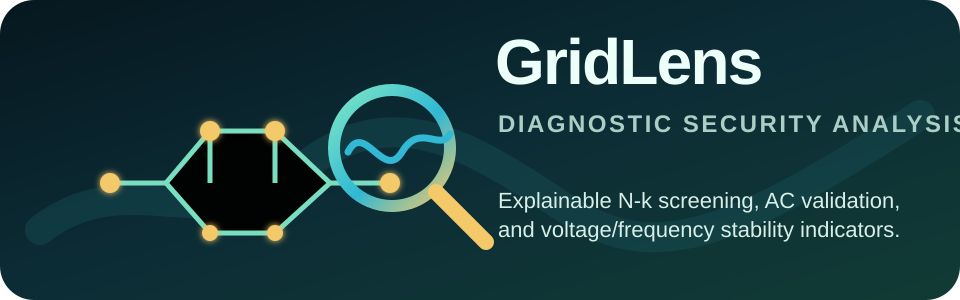

<p align="center">
  
</p>

# GridLens: Batched AC Power Flow And Explainable N-k Security Analysis

GridLens is an open-source, pandapower-backed toolkit for fast balanced AC power flow, contingency screening, and explainable diagnostic security analysis on transmission-style grids. It provides a CPU-first reference path with sparse SuperLU factorizations and a GPU-compatible JAX path built around the same aligned topology/scenario data model.

The project has two layers:

- **Batched Power Flow Core**: JAX and CPU sparse Newton solvers built from pandapower network data.
- **GridLens Diagnostics**: a professional diagnostic/security layer that explains singularities, infeasibility, non-convergence, voltage/frequency risk indicators, and N-k SAFE / UNSAFE verdicts.

## Performance Architecture

The fast contingency path is layered so that acceleration does not weaken the safety semantics:

- DC PTDF/LODF screening cheaply ranks the full N-1 universe and constructs a selected N-k risk pool.
- CPU AC validation uses sparse Newton iterations with one SuperLU factorization per Jacobian, optional `jacobian_reuse`, and warm starts from the base state.
- N-2 validation can initialize each double outage from its solved N-1 parent, forming a topology tree without reusing a solution as evidence.
- Aligned `(topology, scenario, sparse-entry)` arrays feed the JAX topology batch solver. The same call can run on CPU or a CUDA-enabled JAX device; SuperLU is the CPU backend and is not required on GPU.
- Every requested AC contingency is still solved and checked independently. Batching, warm starts, and Jacobian reuse change execution cost and initial guesses, not the contingency equations or the declared guarantee.

Use `scripts/benchmark_contingency_batching.py` to measure cold/sequential CPU, warm SuperLU batches, Jacobian reuse, and optional JAX execution across network sizes.

## Why This Exists

Modern security analysis needs two things at once: fast screening and clear engineering explanations. A fast solver that only returns `did not converge` is not enough for operations, planning, or research workflows. This repository therefore combines:

- pandapower-compatible data extraction
- batched Newton power-flow formulations
- complete DC N-1 screening and smart N-k screening
- selected or exhaustive AC validation
- diagnostic explanations with causal evidence and remedial actions
- voltage and frequency stability indicators

## Solver Formulation

The JAX solver follows a standard transmission-network Newton formulation:

- state: `[theta_PV/PQ, V_PQ]`
- mismatch: `[Pcalc - Pspec, Qcalc - Qspec]`
- sparse `Ybus` products through JAX `BCOO`
- matrix-free Jacobian-vector products via `jax.linearize`
- GMRES Newton corrections via `jax.scipy.sparse.linalg.gmres`
- optional fast-decoupled preconditioning

The data source is pandapower. The adapter converts balanced AC pandapower networks into internal arrays: `Ybus`, `Yf`, `Yt`, `Sbus`, bus types, voltage starts, branch mappings, and limit metadata.

## GridLens Diagnostics

GridLens is the explainability and safety-reporting layer. It is designed for real engineering workflows where a failed contingency must be explainable, not just marked as failed.

GridLens can explain:

- islanded or singular DC contingencies
- missing slack/reference sources
- load islands without frequency/reference support
- structurally disconnected or rank-deficient admittance models
- zero or near-zero impedance data defects
- non-converged AC power flow with top residual buses
- voltage limit violations, voltage margins, and voltage spread
- DC and AC branch loading violations
- frequency-risk proxies from island balance and slack support

GridLens reports:

- `SAFE` / `UNSAFE` verdicts for the declared N-k scope
- exact guarantee scope
- violated contingencies
- min/max AC voltage
- max DC and AC loading
- AC convergence counts
- voltage and frequency stability indicators
- possible actions and cautions

Read more: [docs/diagnostics.md](docs/diagnostics.md)

## Installation And Environment

Use the provided `jax` conda environment:

```powershell
& 'C:\Users\elpetros\.conda\envs\jax\python.exe' -m pytest
```

For scripts:

```powershell
$env:PYTHONPATH='src'
```

## Quick Start

### Batched AC Solve

```python
import pandapower.networks as pn

from batched_powerflow import NewtonOptions, from_pandapower, solve_batch
from batched_powerflow.pandapower_adapter import make_random_load_sbus_batch

net = pn.case14()
model = from_pandapower(net)
sbus_batch, _ = make_random_load_sbus_batch(net, n_scenarios=128, low=0.8, high=1.2, seed=1)

result = solve_batch(model, sbus_batch, NewtonOptions(max_iterations=12))
print(result.converged.mean(), result.vm.shape)
```

### CPU Sparse Large-Grid Solve

```python
import pandapower.networks as pn

from batched_powerflow import CpuNewtonOptions, from_pandapower, solve_batch_cpu_sparse
from batched_powerflow.pandapower_adapter import PandapowerBuildOptions

net = pn.case9241pegase()
model = from_pandapower(net, options=PandapowerBuildOptions(preconditioner="none"))
result = solve_batch_cpu_sparse(model, options=CpuNewtonOptions(max_iterations=30, tolerance=1e-10))

print(result.converged[0], result.mismatch_norm[0])
```

### Explain A Failed Contingency

```powershell
$env:PYTHONPATH='src'
& 'C:\Users\elpetros\.conda\envs\jax\python.exe' scripts\diagnostic_explain.py --case case33bw --outage line:0
```

This produces a causal report: islanded topology, load island without slack/reference, rank-deficient `Ybus`, high residual hot spots, and remedial actions.

### Complete N-k Diagnostic Security Analysis

Defaults to complete N-1 over active lines and transformers:

```powershell
$env:PYTHONPATH='src'
& 'C:\Users\elpetros\.conda\envs\jax\python.exe' scripts\diagnostic_security_analysis.py --case case14
```

Run N-2 over a selected N-1 risk pool:

```powershell
$env:PYTHONPATH='src'
& 'C:\Users\elpetros\.conda\envs\jax\python.exe' scripts\diagnostic_security_analysis.py --case case14 --k 2 --elements line --n1-pool 6 --top-n 5
```

For a complete, auditable N-2 run on a tractable network, disable pruning and enumerate every active branch pair:

```powershell
& 'C:\Users\elpetros\.conda\envs\jax\python.exe' scripts\diagnostic_security_analysis.py --case case14 --k 2 --elements line --exhaustive-nk --pruning none --ac-mode all
```

The resulting `security.certificate` contains candidate/result hashes and coverage counts. Risk-pool pruning is useful for triage, but omitted contingencies cannot support a complete `SAFE` claim unless a separately proven conservative bound certifies them.

Generate a full real-output showcase:

```powershell
$env:PYTHONPATH='src'
& 'C:\Users\elpetros\.conda\envs\jax\python.exe' examples\diagnostic_showcase.py --out benchmark_results\diagnostic_showcase.md
```

Generated example report: [benchmark_results/diagnostic_showcase.md](benchmark_results/diagnostic_showcase.md)

Additional focused tutorials are in [examples/README.md](examples/README.md): scenario batching, exhaustive N-1 AC validation, N-2 parent-tree warm starts, and causal diagnostics.

## Real Workflow Pattern

1. Build a pandapower network.
2. Solve the base AC case.
3. Run complete DC N-1 screening over selected active elements.
4. Treat singular/islanded DC cases as unsafe unless intentional island operation is modeled.
5. AC-validate all contingencies for a full AC guarantee, or top-N for fast triage.
6. Use GridLens explanations to identify causal mechanisms and remedial actions.
7. Re-run after topology, dispatch, voltage support, or protection changes.

## Safety Semantics

GridLens is conservative:

- `SAFE` means every check in the declared scope passed.
- `UNSAFE` means at least one check failed, or the requested guarantee is incomplete.
- Complete DC N-1 certifies only the DC approximation.
- AC N-k safety requires exhaustive AC validation of every N-k contingency in the selected universe.
- Top-N AC validation is useful for screening, but not a complete AC guarantee.
- Islanded, singular, and non-converged contingencies are treated as unsafe.

## Stability Indicators

Voltage indicators:

- `voltage.ac_min_vm_pu`
- `voltage.ac_max_vm_pu`
- `voltage.ac_voltage_limit_violations`
- `voltage.ac_minimum_voltage_margin`
- `voltage.ac_voltage_spread`

Frequency indicators:

- `frequency.island_slack_support`
- `frequency.scheduled_active_power_imbalance`
- `frequency.dynamic_frequency_data`

Power flow alone cannot compute RoCoF or frequency nadir. Frequency indicators are therefore static proxies unless inertia/governor metadata is supplied.

## Benchmarks

All numbers below are from the checked-in benchmark artifacts under `benchmark_results/` and were run in the local `jax` conda environment on CPU. JAX reported only `CpuDevice(id=0)`, so these are not GPU timings. AC PF execution times exclude JAX compilation; the CPU sparse table separates pandapower model extraction (`build s`) from Newton solve execution (`solve s`).

The new contingency profiler measures 32 N-1 cases per network (20 for case14), including model extraction and sparse Newton execution. The fastest observed CPU configuration in that run was:

| case | buses | best measured mode | batch | total s | converged |
|---|---:|---|---:|---:|---:|
| `case14` | 14 | SuperLU + Jacobian reuse 2 | 32 | 1.088 | 19/20 |
| `case30` | 30 | SuperLU + Jacobian reuse 2 | 8 | 2.385 | 30/32 |
| `case57` | 57 | SuperLU | 32 | 1.728 | 32/32 |
| `case118` | 118 | SuperLU + Jacobian reuse 2 | 8 | 1.766 | 30/32 |
| `case300` | 300 | SuperLU + Jacobian reuse 2 | 1 | 2.134 | 26/32 |

These are timing observations, not universal speed guarantees. The `converged` counts and infinite maximum residuals in rows with singular/islanded outages are intentional: GridLens records those contingencies as unsafe rather than dropping them. See the full [contingency batching CSV](benchmark_results/contingency_batching.csv) and [Markdown report](benchmark_results/contingency_batching.md).

Run structured benchmarks:

```powershell
$env:PYTHONPATH='src'
& 'C:\Users\elpetros\.conda\envs\jax\python.exe' scripts\benchmark_scalability.py --mode all --cases case118 case300 case1354pegase --batch-case case118 --batch-sizes 1 8 32 128 --contingency-case case118
```

Run backend comparisons:

```powershell
$env:PYTHONPATH='src'
& 'C:\Users\elpetros\.conda\envs\jax\python.exe' scripts\compare_backends.py --mode base --base-cases case118 case300 case6470rte case9241pegase
```

### AC Power Flow: Pandapower Test Cases

Source: [benchmark_results/cpu_sparse_full_dc_init_tol1e10/case_scalability.csv](benchmark_results/cpu_sparse_full_dc_init_tol1e10/case_scalability.csv)

| pandapower case | buses | state | build s | AC PF solve s | converged | mismatch |
|---|---:|---:|---:|---:|---|---:|
| `case118` | 118 | 181 | 0.054 | 0.019 | yes | 7.39e-14 |
| `case300` | 300 | 530 | 0.065 | 0.023 | yes | 8.24e-13 |
| `case1354pegase` | 1354 | 2447 | 0.068 | 0.038 | yes | 3.80e-12 |
| `case1888rte` | 1888 | 3503 | 0.062 | 0.129 | yes | 8.18e-12 |
| `case2848rte` | 2848 | 5325 | 0.071 | 0.137 | yes | 1.45e-11 |
| `case2869pegase` | 2869 | 5227 | 0.059 | 0.124 | yes | 6.10e-12 |
| `case3120sp` | 3120 | 5991 | 0.070 | 0.122 | yes | 8.48e-12 |
| `case6470rte` | 6470 | 12486 | 0.098 | 0.362 | yes | 1.73e-11 |
| `case6495rte` | 6495 | 12491 | 0.110 | 0.271 | yes | 1.00e-11 |
| `case6515rte` | 6515 | 12536 | 0.118 | 0.283 | yes | 1.05e-11 |
| `case9241pegase` | 9241 | 17036 | 0.143 | 0.403 | yes | 5.20e-12 |

Interpretation: after matching pandapower's `init="auto"` / DC-angle initialization, the CPU sparse Newton backend converged on the tested pandapower transmission benchmark cases through `case9241pegase` with residuals around `1e-11` or lower.

### Base AC Backend Comparison

Source: [benchmark_results/backend_comparison/base.csv](benchmark_results/backend_comparison/base.csv)

Median execution-only times:

| case | buses | ours CPU sparse s | pandapower `runpp` s | LightSim2Grid `runpp` s | speedup vs pandapower | ours / LightSim |
|---|---:|---:|---:|---:|---:|---:|
| `case118` | 118 | 0.008 | 0.034 | 0.025 | 4.4x | 0.3x |
| `case300` | 300 | 0.015 | 0.039 | 0.028 | 2.7x | 0.5x |
| `case1354pegase` | 1354 | 0.039 | 0.064 | 0.037 | 1.6x | 1.1x |
| `case6470rte` | 6470 | 0.239 | 0.374 | 0.101 | 1.6x | 2.4x |
| `case9241pegase` | 9241 | 0.266 | 0.372 | 0.145 | 1.4x | 1.8x |

Interpretation: the CPU sparse backend is faster than pure pandapower `runpp` on these base AC solves. LightSim2Grid is still faster on the large cases.

### Complete N-1 Security Workflow On Large Cases

Source: [benchmark_results/realistic_large_screening_dc_init_tol1e10/summary.csv](benchmark_results/realistic_large_screening_dc_init_tol1e10/summary.csv)

This is the hierarchical workflow: complete DC N-1 LODF/PTDF screening over active `line + trafo` outages, then CPU sparse AC validation for the top 20 selected contingencies.

| case | N-1 candidates | DC failed/islanded | DC screen s | AC top-N | AC validate s | AC converged | max AC mismatch |
|---|---:|---:|---:|---:|---:|---:|---:|
| `case6470rte` | 9005 | 2084 | 12.816 | 20 | 14.260 | 15/20 | 2.09e-11 |
| `case6495rte` | 9019 | 2117 | 12.238 | 20 | 12.552 | 15/20 | 1.51e-11 |
| `case6515rte` | 9037 | 2133 | 12.718 | 20 | 10.732 | 17/20 | 1.62e-11 |
| `case9241pegase` | 16049 | 1402 | 42.265 | 20 | 13.644 | 18/20 | 1.21e-11 |

Interpretation: complete DC N-1 screening is tractable on 6k-9k bus cases. The AC-converged selected cases have residuals around `1e-11`; failed/islanded or singular contingencies are treated as unsafe by GridLens.

### Smart N-k Security Workflow

Source: [benchmark_results/smart_nk_screening_dc_init_ac_tol1e10/summary.csv](benchmark_results/smart_nk_screening_dc_init_ac_tol1e10/summary.csv)

This workflow performs complete N-1 screening, builds a high-risk N-1 pool of 80 outages, then evaluates exact DC multi-outage LODF combinations over that pool with top-10 AC validation.

| case | k | N-1 total | N-1 failed | N-1 screen s | pool | N-k combos | N-k failed | N-k screen s | exhaustive over pool | AC converged top10 | AC max mismatch |
|---|---:|---:|---:|---:|---:|---:|---:|---:|---|---:|---:|
| `case6470rte` | 2 | 9005 | 2084 | 12.551 | 80 | 3160 | 3 | 11.963 | true | 2/10 | 1.26e-11 |
| `case6470rte` | 3 | 9005 | 2084 | 12.551 | 80 | 20000 | 14 | 31.657 | false | 1/10 | 1.45e-11 |
| `case9241pegase` | 2 | 16049 | 1402 | 41.220 | 80 | 3160 | 1 | 32.681 | true | 1/10 | 1.25e-11 |
| `case9241pegase` | 3 | 16049 | 1402 | 41.220 | 80 | 20000 | 7 | 76.417 | false | 6/10 | 7.71e-12 |

Interpretation: these large cases are not N-k secure under the tested DC universe because complete N-1 already contains many failed/islanded contingencies. N-2 over the selected 80-outage risk pool is exhaustive over that pool; N-3 was capped at 20,000 combinations and is therefore a screening result, not a guarantee.

### Small Complete AC N-1 Comparison

Source: [benchmark_results/backend_comparison_small_security/security.csv](benchmark_results/backend_comparison_small_security/security.csv)

| case | complete N-1 cases | our complete DC screen s | our selected AC top20 s | LightSim2Grid C++ AC compute s | pandapower complete AC s |
|---|---:|---:|---:|---:|---:|
| `case118` | 186 | 0.049 | 0.235 | 0.169 | 7.560 |
| `case300` | 411 | 0.056 | 0.590 | 1.210 | 24.167 |

Interpretation: complete DC screening is much faster than complete AC security analysis, but it is not the same guarantee. For full AC N-1, LightSim2Grid's C++ contingency engine is the stronger baseline. The GridLens workflow is intended to combine complete DC guarantees, selected AC validation, and explainable failure reports.

### Current Observed Behavior

- CPU sparse Newton is faster than pure pandapower `runpp` for tested base AC solves.
- LightSim2Grid remains faster than this CPU sparse backend for large base AC solves and full AC security-analysis style workflows.
- JAX reports only `CpuDevice(id=0)` in the current conda environment; GPU benchmarks require CUDA-enabled `jaxlib`.

See [benchmark_results/report.md](benchmark_results/report.md) for additional JAX batch-scaling, contingency-scaling, and implementation notes.

## Scope And Limitations

Supported well:

- balanced AC pandapower networks
- standard buses, lines, transformers, impedances, shunts, loads, static generators, generators, and external grids
- arbitrary radial or meshed topology
- scenario batches for one topology
- branch N-1, N-2, and smart N-k contingency screening
- diagnostic reporting for singularities, infeasibility, voltage/frequency indicators, and security verdicts

Important limitations:

- not a three-phase unbalanced distribution solver
- not a transient-stability simulator
- dynamic TDPF and distributed slack are not part of the JAX residual formulation
- topology-batched AC contingencies require compatible bus/PV/PQ/ref state dimensions
- full AC N-k guarantees are combinatorial and require exhaustive AC validation

## Repository Map

- `src/batched_powerflow/solver.py`: JAX batched Newton-GMRES solver.
- `src/batched_powerflow/cpu_solver.py`: CPU sparse Newton solver.
- `src/batched_powerflow/pandapower_adapter.py`: pandapower extraction and model building.
- `src/batched_powerflow/dc_screening.py`: DC N-1 and smart N-k screening.
- `src/batched_powerflow/diagnostics.py`: GridLens diagnostics and security reports.
- `src/batched_powerflow/contingency.py`: aligned topology batches, CPU SuperLU validation, warm starts, and N-2 parent-tree helpers.
- `scripts/diagnostic_explain.py`: single-case explanation CLI.
- `scripts/diagnostic_security_analysis.py`: complete N-k security CLI.
- `scripts/benchmark_contingency_batching.py`: reproducible network-size and batch-size profiler.
- `examples/diagnostic_showcase.py`: real workflow showcase generator.

## Verification

Run:

```powershell
& 'C:\Users\elpetros\.conda\envs\jax\python.exe' -m pytest -q
```

The current suite covers solver parity, DC screening, N-k screening, diagnostics, stability indicators, and command-facing security-analysis behavior.

## License And Citation

GridLens is licensed under the [Apache License 2.0](LICENSE). The license permits use, modification, and redistribution subject to its terms and notices. For academic or technical publications, please cite the software using [CITATION.cff](CITATION.cff); this is a scholarly request, not an additional licensing restriction. A project notice is included in [NOTICE](NOTICE).

```bibtex
@software{gridlens_2026,
  author  = {elpetros99},
  title   = {GridLens: Batched AC Power Flow And Explainable N-k Security Analysis},
  version = {0.3.0},
  year    = {2026},
  url     = {https://github.com/elpetros99/GridLens},
  license = {Apache-2.0}
}
```
