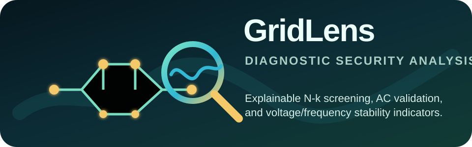

<p align="center">
  
</p>

# GridLens Diagnostics

GridLens is the diagnostic security-analysis layer for this project. It turns power-flow failures and contingency-analysis results into explainable engineering reports with evidence, likely causes, stability indicators, and remedial actions.

It is built for real workflows:

- screen many contingencies quickly
- identify which cases are unsafe
- explain why they failed
- rank voltage, loading, islanding, and frequency-risk indicators
- decide whether a result is a scoped guarantee or only a screening result

## Core Capabilities

GridLens explains:

- singular or islanded DC contingencies
- missing slack/reference sources
- load islands without frequency/reference support
- structurally disconnected or rank-deficient admittance models
- zero or near-zero impedance branch data defects
- non-converged AC power flow with top residual buses
- voltage limit violations and voltage margin/spread
- branch loading violations in DC screening and selected AC validation
- frequency-risk proxies based on island slack support and scheduled active-power imbalance

GridLens reports:

- `SAFE` / `UNSAFE` verdict
- exact guarantee scope
- failed, islanded, overloaded, non-converged, or voltage-violating contingencies
- min/max AC voltage
- max DC and AC loading
- AC validation count and convergence count
- voltage and frequency stability indicators
- suggested actions with rationale and risk notes

## Python API

```python
from batched_powerflow import (
    complete_diagnostic_security_analysis,
    explain_powerflow,
    explain_dc_screening_result,
)
```

One-case explanation:

```python
report = explain_powerflow(net, model=model, result=result)
print(report.to_markdown())
```

Complete security analysis:

```python
security = complete_diagnostic_security_analysis(
    net,
    k=1,
    elements=("line", "trafo"),
    ac_mode="top",
    top_n=20,
)
print(security.safe)
print(security.to_markdown())
```

### Fast AC validation controls

AC validation is CPU-first and uses SciPy SuperLU sparse factorization by default. Each Newton step factors its sparse Jacobian once and solves with that factor; `CpuNewtonOptions(jacobian_reuse=2)` enables an inexact-Newton tradeoff that reuses the same Jacobian/factorization for two steps. Warm starts can be supplied automatically from the base case for N-1 and from a parent N-1 solution for N-2:

```python
from batched_powerflow import CpuNewtonOptions

security = complete_diagnostic_security_analysis(
    net,
    k=2,
    elements=("line",),
    n1_pool=32,
    top_n=32,
    ac_mode="top",
    ac_backend="cpu",
    ac_batch_size=32,
    ac_warm_start=True,
    cpu_options=CpuNewtonOptions(jacobian_reuse=2, max_iterations=30, tolerance=1e-10),
)
```

Set `ac_backend="jax"` to use the topology-batched JAX implementation. Its aligned `(topology, scenario, sparse-entry)` arrays are the GPU-compatible path; on a CUDA-enabled JAX installation the same call can run on GPU. CPU SuperLU and JAX are separate linear-algebra backends, so SuperLU is not copied to the GPU.

The N-2 tree changes only the initial guess. Every requested contingency still gets its own AC solve and safety checks. Warm starts, Jacobian reuse, and topology batching accelerate validation but do not constitute a mathematical safety proof by themselves; the guarantee remains exhaustive only when the declared contingency universe is exhaustively screened and AC-validated.

For an auditable full-universe N-2 run on a tractable network, use:

```python
security = complete_diagnostic_security_analysis(
    net,
    k=2,
    elements=("line",),
    exhaustive_nk=True,
    pruning="none",
    ac_mode="all",
    max_cases=None,
)
print(security.safe)
print(security.certificate.to_json())
```

The certificate records the declared universe, candidate/result hashes, DC and AC counts, unresolved AC cases, residual tolerance, convergence counts, and parent-tree coverage. `exhaustive_ac=True` means every declared case was attempted; `ac_unresolved` and `ac_converged` show whether those attempts actually produced converged solutions. A certificate is an auditable numerical record under the selected pandapower/JAX model and tolerances; it is not a formal theorem about unmodelled physics.

Pruning is allowed for triage with `pruning="risk_pool"` (the default): it evaluates N-2 combinations over a selected high-risk N-1 pool and cannot produce a complete network-wide `SAFE` claim. For a complete claim, do not prune potentially safe cases. It is always safe to short-circuit further AC work for a case already proven unsafe by an exact DC/topology check, but that case must remain counted as unsafe in the certificate. LODF ranking alone is not a proof that an omitted AC contingency is safe.

### Large PEGASE cases

For cases above 1,000 buses, use the bounded risk-pool workflow:

```powershell
$env:PYTHONPATH='src'
& 'C:\Users\elpetros\.conda\envs\jax\python.exe' examples\tutorial_large_pegase_n2.py --case case1354pegase --n1-pool 80 --top-n 20
```

This performs complete N-1 DC screening, exact multi-outage DC evaluation over `C(80, 2) = 3,160` N-2 pairs, and batched warm-started AC validation of the top 20. The same tutorial accepts `case2869pegase` and `case9241pegase`. The full N-2 universe is much larger (`C(1,991, 2)` for the active line+transformer branches in the 1,354-bus case), so it should not be materialized or AC-solved blindly. The certificate is exhaustive over the selected risk-pool universe, not over the full network universe.

## Command-Line Workflows

Explain one failed or suspicious case:

```powershell
$env:PYTHONPATH='src'
& 'C:\Users\elpetros\.conda\envs\jax\python.exe' scripts\diagnostic_explain.py --case case33bw --outage line:0
```

Run complete diagnostic security analysis, defaulting to N-1:

```powershell
$env:PYTHONPATH='src'
& 'C:\Users\elpetros\.conda\envs\jax\python.exe' scripts\diagnostic_security_analysis.py --case case14
```

Run N-2 over a selected N-1 risk pool:

```powershell
$env:PYTHONPATH='src'
& 'C:\Users\elpetros\.conda\envs\jax\python.exe' scripts\diagnostic_security_analysis.py --case case14 --k 2 --elements line --n1-pool 6 --top-n 5
```

Use `--ac-backend jax`, `--ac-batch-size 64`, `--jacobian-reuse 2`, or `--no-ac-warm-start` to compare execution strategies.

Generate a multi-scenario showcase from real pandapower networks:

```powershell
$env:PYTHONPATH='src'
& 'C:\Users\elpetros\.conda\envs\jax\python.exe' examples\diagnostic_showcase.py --out benchmark_results\diagnostic_showcase.md
```

## Safety Semantics

The verdict is intentionally conservative.

- `SAFE` means all checks in the declared `guarantee_scope` passed.
- `UNSAFE` means at least one selected check failed, or the requested guarantee is incomplete.
- Complete DC N-1 can certify only the DC approximation.
- AC N-k safety requires exhaustive AC validation of every N-k contingency in the selected universe.
- Top-N AC validation is useful for workflow speed, but it is not a full AC guarantee.
- Islanded, singular, or non-converged contingencies are treated as unsafe.

## Stability Indicators

Voltage indicators:

- `voltage.ac_min_vm_pu`
- `voltage.ac_max_vm_pu`
- `voltage.ac_voltage_limit_violations`
- `voltage.ac_minimum_voltage_margin`
- `voltage.ac_voltage_spread`

Frequency indicators:

- `frequency.island_slack_support`: detects energized load islands without slack/reference support.
- `frequency.scheduled_active_power_imbalance`: static proxy for frequency-control burden.
- `frequency.dynamic_frequency_data`: reports whether inertia/governor metadata is available.

Power-flow data alone cannot compute RoCoF or frequency nadir. To make frequency indicators quantitative, add machine inertia/governor metadata such as `h_s`, `inertia_s`, `droop_percent`, or `governor_droop` to generator tables and connect this diagnostic layer to a dynamic model.

## Example: Islanding Contingency

Command:

```powershell
$env:PYTHONPATH='src'
& 'C:\Users\elpetros\.conda\envs\jax\python.exe' scripts\diagnostic_explain.py --case case33bw --outage line:0
```

Interpretation:

- Status: `insecure_or_infeasible`
- Cause: `line:0` splits the network.
- Evidence: DC screen reports `islanded DC topology`; the post-contingency island has load but no slack/reference; the internal `Ybus` is disconnected and structurally rank deficient.
- Stability indicators: frequency island support is critical; voltage magnitude collapses in the unsupported island.
- Actions: restore connectivity, add one valid reference per intentional island, or shed/transfer load before solving.

## Example: Complete N-1 Security

Command:

```powershell
$env:PYTHONPATH='src'
& 'C:\Users\elpetros\.conda\envs\jax\python.exe' scripts\diagnostic_security_analysis.py --case case14 --k 1 --elements line --top-n 3 --ac-mode top
```

Report contents:

- complete DC N-1 screen over selected line outages
- AC validation for the top 3 selected contingencies
- SAFE / UNSAFE verdict
- max DC loading
- max AC loading
- min/max AC voltage
- voltage and frequency stability indicators
- violations, if any

## Real Workflow Pattern

1. Run base-case AC power flow.
2. Run complete DC N-1 screening over active lines/transformers.
3. Treat singular/islanded DC cases as unsafe unless operational islanding is explicitly allowed and modeled.
4. AC-validate all contingencies for a guarantee, or top-N contingencies for fast screening.
5. Use GridLens reports to explain failures and prioritize remedial actions.
6. Re-run the same command after topology, dispatch, voltage support, or protection changes.

## Reproducible performance profiling

The size sweep compares cold/sequential CPU validation, warm-started CPU batches using SuperLU, optional Jacobian reuse, and the GPU-compatible JAX topology path (on the currently available JAX device):

```powershell
& 'C:\Users\elpetros\.conda\envs\jax\python.exe' scripts\benchmark_contingency_batching.py --cases case14 case30 case57 case118 --max-contingencies 32 --include-jax
```

It writes CSV, JSON, Markdown, and optionally a `cProfile` dump. Always report the device, network, number of contingencies, convergence count, residual tolerance, and whether JAX compilation time is included when comparing timings.

